# Public demo architecture

How the static Recorded Lab is built and kept separate from the live robot stack.
The replay data format is in [plans/public-replay-contract.md](plans/public-replay-contract.md).

## Status

Implemented: offline deterministic exporters, versioned playback schemas and a
static Recorded Lab with synchronized 2D/3D playback, explicit recording gaps,
visitor-defined checks and an N0/N2 comparison. A separate static site build has
no backend, proxy or WebSocket and excludes recordings unless datasets are
explicitly included. Not deployed yet; datasets need owner approval before
publication. The invitation-only live lab is not implemented.

## Dependency and trust boundaries

```mermaid
flowchart LR
  ROS[Local ROS / Gazebo] --> Backend[Existing local backend / runner]
  Backend --> Evidence[Private reports and MCAP]
  Evidence --> Export[Offline deterministic exporter]
  Export --> Review[Integrity and privacy review]
  Review --> Approval[Owner publication approval]
  Approval --> Static[Static assets on Pages]
  Static --> Replay[Public recorded replay and visitor analysis]
  Guest[Invited attended guest] --> Auth[Restricted authenticated gateway]
  Auth --> Adapter[Allowlisted simulation adapter]
  Adapter --> ROS
```

Public replay has no connection to the local backend or invited-lab command
path. Public data is an intentional derived publication; raw local artifacts,
SQLite, admin APIs, source ZIPs and full MCAP collections stay private. The owner
computer may be off. Live operation stays ROS/backend-owned; browser analysis
cannot start or alter a mission or change authoritative experiment evidence.

## Current frontend and smallest safe reuse

`web/src/main.tsx` imports `App.tsx`, whose component unconditionally mounts
`useTelemetry()` and `useControlCenter()`. These fetch robot/control/readiness
APIs and connect `/api/v1/telemetry/ws`. `vite.config.ts` proxies `/api` to local
FastAPI in development. Current production app also needs a backend to render.
CSS hiding or a route in this App is therefore insufficient for public mode.

Proposed later composition: explicit local and public-demo build entries, selected
before imports/mounting operational components. Prefer a static demo entry and
shared pure rendering modules over a runtime flag that imports the entire local
App. Local entry retains current behavior; demo entry only imports static dataset
loading, playback, read-only visualization and deterministic analysis. Unknown
mode fails closed; never auto-detect localhost or fall back to local services.
Both are the same React/TypeScript/Three.js product, not a framework migration.

Reuse `MapView`, `Robot3DView`, `LaserView` after extracting a narrow read-only view
model; they currently consume `RobotSnapshot`, and MapView has goal-selection
callbacks. Public click/selection may inspect coordinates, never submit goals.
Do not fabricate live readiness/controller states to satisfy old component props.
Reuse presentation from reports only after separating fetch/control dependencies;
public schema must not become another live-state or experiment source of truth.

Public build tests must inspect the emitted dependency graph/bundle and browser
network, not just visible buttons. No operational API/mission/teleop/stack/RViz
modules, localhost/admin origin, secrets or control WebSockets may be reachable.
Proposed CSP: same-origin static fetch/images, required local workers only, no
external script/telemetry/control connections. Exact CSP is tested against the
static app later. No service worker that could retain old local/demo bundles in
v1. Backend-off tests use a sandboxed browser and assert zero `/api/v1/*`, WS/WSS
or off-origin requests. Existing local build has not met this gate.

## Playback dataset v1 — proposed contract

Use small JSON + static scene/map assets initially; do not decode every raw MCAP
in visitors' browsers. [MCAP's browser SDK](https://mcap.dev/docs/typescript/modules/_mcap_browser)
exists but direct remote MCAP browsing is optional later. Offline extraction uses
available ROS MCAP readers and documented message/frame rules.

| Object | Required content / invariants |
|---|---|
| Manifest | `schema_version: 1`, opaque dataset ID, exporter version/source digest, extraction config digest, source report/MCAP/map hashes, source experiment/trial/run IDs, source config/profile/world, ordered relative asset paths/sizes/hashes, limitations, publication review version. No absolute paths/host/account IDs. |
| Original evidence | Immutable source ROS outcome; original pose/contact verdicts and policies; source report ID/hash; measured values and source field paths; absent fields explicitly null + reason. Sanitized derivative retains original hash/reference, not a claim to be the byte-identical report. |
| Scene/map | Occupancy dimensions/resolution/origin including yaw, encoding, units metres/radians, `map -> odom -> base_link` contract and sensor frames; original map hash. Display coordinate transform documented; map imagery origin/row inversion tested. |
| Playback segments | Segment ID/clock epoch, ROS start/end ns as decimal strings, playback start/end integer ms, gap/pause/reset/frame-change boundaries and reasons. Never convert epoch ns to JavaScript Number for arithmetic. |
| Pose/trajectory | Segment, source ROS ns string, relative playback ms, frame, position/yaw and valid/quality flags. Distinguish localized map pose from Gazebo truth and odometry. Missing transform means unavailable, not guessed pose. |
| LiDAR | Timestamp/segment/frame, angular/range units/bounds, deterministic downsample indices; invalid ranges encoded null + reason (no NaN/Infinity JSON). Use only available timestamp-matched TF; do not invent a scan for gaps. |
| Events | Mission/action evidence with explicit semantics; requested/armed/started/applied/ended fault evidence only when actually available. Source IDs, timestamps, epoch and confirmation. No deriving Nav2 acceptance from `navigating` feedback. |
| Metrics/quality | Duration, final position/yaw error, contact observations/coverage and sample availability; metric provenance, missing/stale/corrupt flags, complete interval scope, limitations. Preserve measured values; unavailable does not become zero. |

Allowed source identifiers are opaque run/trial/report IDs, not host names or
user labels. Publish source checksums without local filenames/paths. A private
mapping file links source locations to public asset IDs and stays outside the
bundle. SHA256 verifies byte integrity, not signed authenticity. Removing private
fields changes bytes: hash the sanitized derivative separately; never recompute
an original authoritative report ID and claim it is the original report.

## ROS time, interpolation and extraction determinism

Split on backward clock jumps, explicit epoch/source changes, TF frame changes
and gaps beyond a declared extraction threshold. Within a segment map monotonic
ROS offsets to playback milliseconds using integer arithmetic; retain original
nanoseconds. Paused ROS time has no inferred ROS duration: show a pause marker;
only represent wall duration if the evidence supplies a documented wall clock.
Do not infer wall time from recording order without a declared clock mapping.

Interpolate position and shortest-angle yaw only between valid adjacent poses
in the same segment/frame within the declared gap bound. At a gap/reset, seek
jumps to a marked segment; no connecting path or fabricated movement. Scans/events
use explicit sample/step semantics, not invented interpolation. Do not claim
the replay shows every control or physics update after deterministic downsampling.

Canonical key ordering, stable extraction seed/settings, sample selection and
asset naming yield identical bytes/hashes for identical inputs. Keep volatile
export timestamps out of hashed content or in a separate publication receipt.
Tests compare representative decoded MCAP values/timestamps and report fields
against export, verify all asset hashes, and reject tampering, unsafe paths,
unknown versions, impossible time/frame transitions and oversized input. A second
independent check reviews extracted source samples before publication.

## Visitor-defined validation, separate from original results

Display original evidence in a fixed panel and visitor policy/results in a
separate panel labelled **Visitor-defined validation / What-if analysis**.
Controls run deterministic calculations on recorded values, not Nav2/Gazebo.
Use explicit values/units and display the chosen policy with each outcome.

Proposed check semantics (unit-tested before UI implementation):

- Duration: PASS when finite available measured ROS seconds <= threshold;
  FAIL when greater. Reject negative/nonfinite threshold; missing data UNKNOWN.
- Position error: planar Euclidean distance of trustworthy final pose to goal;
  PASS <= metres threshold, otherwise FAIL. Missing/stale/frame-invalid evidence
  UNKNOWN. Do not use the visitor threshold to rehabilitate corrupt evidence.
- Yaw: wrapped angular absolute error in [0,pi]; PASS <= radians threshold,
  otherwise FAIL; missing valid final orientation UNKNOWN.
- Observed non-support contact: detected contact may fail a visitor's
  no-observed-contact criterion. `NO_CONTACT_OBSERVED` supports only a named
  **no observed contact within monitored coverage** check when coverage is valid;
  it never proves universal collision absence. Missing/incomplete coverage is
  UNKNOWN; universal collision-free claims are NOT ASSESSABLE.
- Data quality: evaluate declared required fields/coverage/time/frame integrity.
  Corruption or missing required evidence blocks affected checks; never silently
  remove unknown checks from an aggregate and call the dataset a pass.

Do not create a combined authoritative mission-success verdict. Any optional
visitor summary retains the individual PASS/FAIL/UNKNOWN results and explicit
unknown policy. Export analytical results as `visitor_analysis_version`, source
dataset hashes, selected policy, check values/status/reasons and clear
`not_an_authoritative_experiment_report` marker. It must not reuse authoritative
report IDs/schema/download names. Original artifact bytes never change.

Replay UI later includes play/pause/seek/speed, scenario switch, synchronized
map/3D/scan/events, accessible controls/mobile layout and persistent
**RECORDED DEMO** labels. Normal-vs-slow differences are descriptive; configuration,
instrumentation, missing evidence and teardown failures must remain visible.
Only independently qualified faults may become public fault examples.

## Hosting and owner approval

Cloudflare Pages static-only, `*.pages.dev`, no paid upgrades/functions/storage.
Candidate `web` root, lockfile-based `npm ci && npm run build`, output `dist`;
a dedicated demo build script/entry will be verified before recommending actual
account settings. Current settings build the local app, not a publishable demo.
[Build configuration](https://developers.cloudflare.com/pages/configuration/build-configuration/)
and [monorepo guidance](https://developers.cloudflare.com/pages/configuration/monorepos/)
support explicit root/output settings. [Serving Pages](https://developers.cloudflare.com/pages/configuration/serving-pages/)
documents SPA fallback when no top-level 404 page exists; verify actual deep links
instead of assuming this works for the chosen export. Source visibility is an
independent owner decision. Public preview URLs also count as publication:
owner permission and sanitized assets are required before any upload.

## Invitation-only live lab — deferred trust model

A future distinct gateway is the only possible tunnel target, loopback-bound and
limited to approved simulation scenarios. The existing FastAPI app, Vite proxy
and ROS/DDS remain private. Serve guest assets and authenticated HTTP/WebSocket
from one guest origin, separate from local admin origin and the public replay site.

| Threat | Required boundary and verification before exposure |
|---|---|
| URL leak/unauthorized guest | Gateway authentication + per-session capability, least privilege, no tokens in URLs/logs; unauthorized routes and sockets fail closed. Tunnel/link alone is insufficient. |
| Cross-origin/CSRF/session reuse | Strict origin checks, secure session cookies/tokens, appropriate CSRF protection, WS handshake authorization and expiry; test revoked/stale sessions. |
| Arbitrary command/path/physical access | Fixed scenario/profile/goal allowlist, bounded inputs/rates/sizes, server rejects real/replay/hardware; no generic ROS, shell, config uploads, paths or admin proxy routes. |
| Multiple operators/resource exhaustion | One operator/runtime lease, finite monotonic wall TTL (initial proposal 10 minutes), limits and audit; failed cleanup quarantines the session and blocks new work. |
| Disconnect/expiry/restart | Bounded mission cancel/stop with terminal confirmation, stale callback/ownership guards, deterministic owned-process teardown. Owner local kill switch remains usable without browser/tunnel. |
| Host/network escape | Independently reviewed network/filesystem/process isolation; container branding alone is not evidence. Guests cannot reach host services/admin/DDS. |

Transport is conditional and untested locally. [Quick Tunnel docs](https://developers.cloudflare.com/tunnel/get-started/quick-tunnels/)
document email restrictions, no uptime guarantee and no SSE; the
[reported authentication-expiry issue #1752](https://github.com/cloudflare/cloudflared/issues/1752)
remains open when checked 2026-10-11. This is an upstream report, not a reproduced
local result or proof every version fails. Verify the exact client/browser before
considering it. Never fall back to an unprotected tunnel to bypass auth failure.
[Tailscale Funnel](https://tailscale.com/docs/features/tailscale-funnel) makes a
public endpoint and still requires gateway authentication;
[Personal pricing](https://tailscale.com/pricing) currently offers a free plan,
subject to owner eligibility/limits and recheck. Tailnet Serve is a private
invitation alternative if guest setup is acceptable. If no free secure transport
passes, keep live operation local/attended video; static replay stays independent.

No gateway/exposure readiness is claimed. Exact owner session/access/scenario
choices, local adversarial tests, independent security review, transport testing
and witnessed separate-network guest acceptance are required in WP4/WP5.
